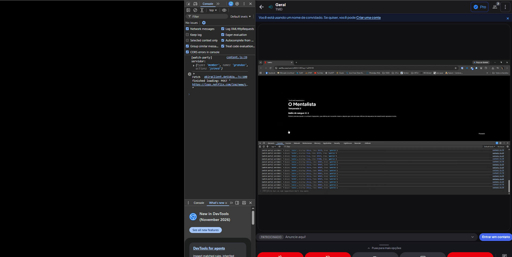

# Streaming Duo 🍿

Extensão de navegador para assistir Netflix **sincronizado à distância**: quando uma pessoa pausa, dá play ou pula um trecho, o vídeo da outra acompanha em tempo real.

Eu e minha namorada já usávamos uma extensão pronta para assistir séries juntos à distância. Resolvi construir a nossa própria: privada, open source e sem nossos dados passando por serviços de terceiros.

> ⚠️ Projeto educacional, sem afiliação com a Netflix. Usa uma API interna não documentada do player, que pode mudar a qualquer momento.



---

## Como funciona

1. O host abre um episódio e clica em **Criar sala** no popup da extensão.
2. A extensão gera um link de convite: `netflix.com/watch/<id>?wp=<sala>`.
3. A convidada abre o link e entra na sala automaticamente, já no ponto certo do episódio.
4. Play, pause e seek de qualquer um dos dois são replicados para o outro.

## Stack

- **Servidor:** Node.js + [`ws`](https://github.com/websockets/ws) (WebSocket puro, sem Socket.io)
- **Extensão:** Chrome Extension Manifest V3, JavaScript puro
- **Deploy:** Render

## Estrutura

```
server/
  server.js        # salas, protocolo e repasse de mensagens
extension/
  manifest.json
  page.js          # controle do player (contexto da página)
  content.js       # ponte entre página e servidor (contexto isolado)
  popup.html
  popup.js         # criação de sala e link de convite
docs/
  demo.gif
```

## Arquitetura

O projeto tem duas partes: o **servidor** e a **extensão**. A extensão, por sua vez, é dividida em três peças, porque cada uma roda num contexto diferente do navegador.

### Servidor

Node.js com `ws`. Guarda as salas em memória e repassa mensagens entre os membros de cada sala. Ele não sabe nada sobre Netflix: só recebe, valida e repassa.

Dois mapas formam todo o estado:
- `rooms`: `Map<roomId, { members, host, lastState }>` responde "quem está nesta sala?"
- `clients`: `Map<socket, { roomId, name }>` responde "de quem é esta conexão e em que sala ela está?"

### Extensão

- **`page.js`** roda no contexto da própria página (`"world": "MAIN"`). É a única peça que enxerga o objeto interno do player da Netflix. Ela lê o estado do vídeo, aplica estados recebidos e detecta ações do usuário pelos eventos do `<video>`.
- **`content.js`** roda no contexto isolado da extensão, que tem acesso às APIs do Chrome mas não às variáveis da página. Mantém a conexão WebSocket, faz a ponte entre a página e o servidor e decide o que deve ou não ser enviado (janelas de supressão e heartbeat do host).
- **`popup`** cria a sala e gera o link de convite.

### Como as peças conversam

- **`page.js` ↔ `content.js`:** `window.postMessage`, com uma etiqueta (`source`) diferente em cada direção, para que nenhum lado processe as próprias mensagens.
- **`popup` → `content.js`:** `chrome.tabs.sendMessage`.
- **`content.js` ↔ servidor:** WebSocket com mensagens JSON (veja [Protocolo](#protocolo)).

### O caminho de uma pausa

1. Você pausa o vídeo e o `<video>` dispara o evento `pause`.
2. O `page.js` lê o estado atual do player e envia para o `content.js`.
3. O `content.js` manda `{ type: "state", playing: false, time }` para o servidor.
4. O servidor atualiza o último estado da sala e repassa para os outros membros, anexando quem enviou.
5. O `content.js` da outra pessoa recebe e pede ao `page.js` para aplicar o estado.
6. O `page.js` faz o seek (se a diferença passar de 1,5 s) e pausa, ignorando os eventos que ele mesmo gerou durante 1 s.

```
┌──────────────── Extensão (aba da Netflix) ────────────────┐
│                                                           │
│  page.js (mundo MAIN)  ◄──postMessage──►  content.js      │
│  controla o player                        (mundo isolado) │
│                                                ▲          │
│  popup.js ──chrome.tabs.sendMessage────────────┘          │
└──────────────────────────────────┬────────────────────────┘
                                   │ WebSocket
                                   ▼
                           ┌───────────────┐
                           │   Servidor    │  salas em memória
                           │  Node + ws    │  repassa mensagens
                           └───────────────┘
```

- **`page.js`** roda no contexto da página (`"world": "MAIN"`), o único que enxerga o objeto interno do player da Netflix. Detecta ações do usuário pelos eventos do `<video>` e aplica estados recebidos.
- **`content.js`** roda no mundo isolado da extensão: mantém a conexão WebSocket e faz a ponte entre página e servidor.
- **`popup`** cria a sala e gera o link de convite.
- **Servidor** guarda as salas em memória e repassa mensagens entre os membros. Não sabe nada sobre Netflix.

## Protocolo

**Cliente → Servidor**

| type     | campos                   |
|----------|--------------------------|
| `create` | `roomId`, `name`         |
| `join`   | `roomId`, `name`         |
| `state`  | `playing`, `time` (ms)   |
| `chat`   | `text`                   |

**Servidor → Cliente**

| type       | campos                                   |
|------------|------------------------------------------|
| `joined`   | `roomId`, `members`, `state`, `isHost`   |
| `state`    | `playing`, `time`, `from`                |
| `member`   | `name`, `action` (`joined` / `left`)     |
| `host`     | `name`                                   |
| `promoted` | —                                        |
| `chat`     | `text`, `from`, `at`                     |
| `error`    | `reason`                                 |

## Decisões técnicas

- **Sincronização por estado, não por evento.** Cada mensagem descreve como o player *está* (`playing` + `time`), em vez do que *aconteceu* (play, pause, seek). Isso reduz os tipos de mensagem e elimina casos de borda, como um seek com o vídeo pausado.
- **Servidor como fonte da verdade.** O cliente nunca informa o próprio nome ou sala depois de entrar: o servidor resolve isso a partir da conexão (`Map<socket, { roomId, name }>`), o que impede alguém de falar numa sala em que não está.
- **`Map` e `Set` em vez de objetos e arrays.** Sockets são usados como chave de `Map`, e os membros de cada sala ficam num `Set` (sem duplicatas, remoção direta).
- **Supressão de eco.** Ao aplicar um estado remoto, o próprio player dispara eventos que pareceriam ações do usuário. Uma janela de 1 s após cada aplicação evita o loop infinito entre os dois clientes.
- **Janela de entrada.** Quem entra pelo link ignora os próprios reports por 5 s, para que o autoplay da Netflix não "puxe" o host para o ponto da convidada.
- **Tolerância de drift.** O seek só acontece se a diferença passar de 1,5 s. Cada seek faz o player rebufferizar, então pequenas diferenças são ignoradas.
- **Heartbeat do host.** O host envia o estado a cada 5 s, o que corrige drift acumulado e sincroniza quem entrou atrasado.
- **Tempo estimado calculado no servidor.** Ao entrar numa sala com vídeo tocando, o servidor soma ao último tempo conhecido o tempo decorrido desde então. A conta fica no servidor porque os relógios dos clientes podem divergir.
- **Host transferível.** Se o host sair, o membro mais antigo assume.

## Rodando localmente

**Servidor**
```bash
cd server
npm install
npm start          # ou: node --watch server.js
```

**Extensão**
1. Em `extension/content.js`, aponte `SERVER_URL` para `ws://localhost:8080`.
2. Abra `chrome://extensions` e ative o **Modo do desenvolvedor**.
3. Clique em **Carregar sem compactação** e selecione a pasta `extension/`.
4. Ao abrir a Netflix, permita o acesso à rede local quando o Chrome pedir (necessário só com o servidor em `localhost`).

## Deploy

O servidor roda no Render como Web Service (Root Directory `server`, build `npm install`, start `npm start`). A porta vem de `process.env.PORT`. Em produção, a extensão se conecta via `wss://`.

## Limitações conhecidas

- Troca de episódio é manual para cada pessoa.
- Sem reconexão automática se a conexão cair.
- Salas vivem na memória do servidor e somem se ele reiniciar.
- Planos com anúncios podem dessincronizar durante os intervalos (o heartbeat corrige depois).

## Roadmap

- [ ] Chat na tela (Shadow DOM, sem conflito com os atalhos de teclado da Netflix)
- [ ] Reconexão automática
- [ ] Aba de sugestões no popup: recomendar filmes e séries com base em referências do casal e notas públicas
- [ ] Separar o servidor em módulos e adicionar testes
- [ ] Publicar na Chrome Web Store

## O que aprendi

- **WebSocket do zero:** handshake de upgrade, eventos (`connection`, `message`, `close`) e por que a mensagem chega como `Buffer`.
- **Desenho de protocolo:** decidir o formato das mensagens antes de escrever código, e separar o que o cliente envia do que o servidor repassa.
- **Contextos de execução em extensões:** content scripts não enxergam as variáveis JS da página, e a ponte entre eles é feita com `postMessage`.- **Sincronização em tempo real:** eco, drift, latência e por que sincronizar estado é mais simples que sincronizar eventos.
- **Engenharia reversa de uma API interna,** explorando objetos globais pelo DevTools até encontrar o player e seus métodos.
- **Armadilhas de JavaScript** que só aparecem na prática: `!valor` com `false` e `0` válidos, `const` preso no escopo de bloco, `clear()` vs `delete()`, timers criados dentro de handlers.
- **Depuração em vários contextos:** console da página, do content script e do popup são separados, e um `catch` genérico pode esconder o erro real.
- **Restrições do navegador:** o Chrome bloqueia conexões de sites públicos para `localhost` até o usuário permitir.
